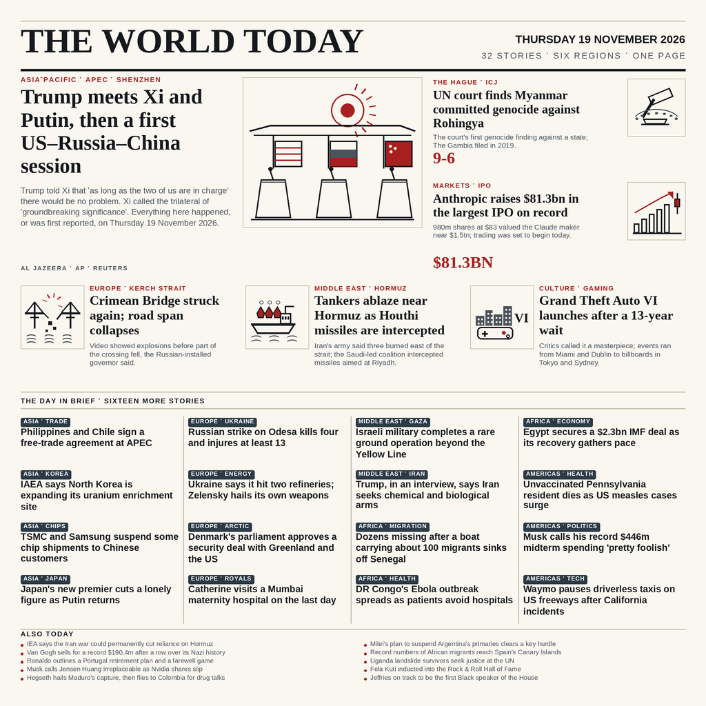

# The World Today — Thursday 19 November 2026

A single-page news front page for the day of 19 November 2026: one 1024×1024 PNG that
carries the stories a reader would need to understand that day — 32 of them, from six
regions, on one broadsheet-style page.



[](https://make.fun/bounty/news-image-20261119?utm_source=github&utm_medium=readme&utm_campaign=news-image-20261119)
[](https://make.fun/bounty/news-image-20261119/leaderboard?utm_source=github&utm_medium=readme&utm_campaign=news-image-20261119)
[](https://make.fun/bounty/news-image-20261119?utm_source=github&utm_medium=readme&utm_campaign=news-image-20261119)

## What the page shows

- **Lead, Asia-Pacific:** APEC leaders' week in Shenzhen. Trump met Xi Jinping and then
  Vladimir Putin one-on-one, before a "family photo" and an unprecedented three-way
  US–Russia–China session at the Kylin Villa.
- **The Hague:** the International Court of Justice ruled 9–6 that Myanmar committed
  genocide against the Rohingya — the first time the court has held a state responsible
  for genocide.
- **Markets:** Anthropic raised $81.3bn in the largest IPO on record, selling 980m shares
  at $83 for a valuation near $1.5tn.
- **Three card stories:** the Crimean Bridge struck again with part of the road span
  collapsing over the Kerch Strait; tankers ablaze near the Strait of Hormuz while the
  Saudi-led coalition intercepted missiles aimed at Riyadh; and Grand Theft Auto VI
  launching worldwide after a 13-year wait.
- **Sixteen briefs** in four regional columns: APEC trade, North Korean enrichment, chip
  shipments to China, Japan's new premier, Odesa, Ukrainian strikes on refineries,
  Greenland's security deal, the royal tour, Gaza's Yellow Line, Iran and chemical
  weapons, the Senegal shipwreck, Ebola in DR Congo, Egypt's IMF deal, US measles, Musk's
  midterm spending and Waymo's freeway pause.
- **Ten "also today" lines** across the foot of the page: Hormuz and the IEA, the Van Gogh
  record, Ronaldo's farewell, Nvidia, Venezuela and Colombia, Argentina's primaries, the
  Canary Islands, Uganda's landslide, Fela Kuti and the speakership race.

Every illustration is an original schematic drawn with geometric primitives — no
publisher photograph, artwork, chart or logo is redistributed, and every summary line is
written for this page. Where a story rests on a single outlet's reporting, the label on
the page says so; the outlet-by-outlet record is in [SOURCES.md](SOURCES.md).

## How it is built

The artwork is rendered at authoring time at twice the final resolution (2048×2048) and
downsampled once with Lanczos, so rules stay crisp and type stays clean at thumbnail
size.

- `tools/render.py` — the renderer. Needs Pillow. It composes the page from the story
  lists at the top of the file, measures every string with `textlength`/`getbbox`, shrinks
  a font by one pixel at a time (to a floor per block) until the text fits its box, and
  writes `entry.png` beside two check artefacts it leaves out of the repository:
  `preview-300.png` (the page at 300 px, for checking that it still reads) and
  `layout-audit.json`.
- `main.py` — the graded entrypoint, **Python standard library only**. It validates the
  committed `entry.png` by hand (signature, a 1024×1024 IHDR, every chunk's CRC32, an
  IEND marker with no trailing bytes, and a decompressible, correctly sized image stream)
  and copies those exact bytes to `$MAKEFUN_OUTPUT_DIR/entry.png`.

`layout-audit.json` records all 69 text boxes with their rectangles, the story count, and
any box that leaves its cell, any pair of boxes that collide, and any truncated or shrunk
string. It is written by the renderer and not committed. The audit for the committed
artwork is clean: 0 out-of-cell, 0 overlaps, 0 truncations, 0 shrunk.

## Running it

```sh
# graded entrypoint: standard library only, no network
MAKEFUN_OUTPUT_DIR=out python3 -P -s main.py
ls -l out/entry.png
```

Rebuilding the artwork (needs Pillow, and the Liberation fonts):

```sh
python3 tools/render.py          # writes entry.png, preview-300.png, layout-audit.json
```

## Files

| Path | What it is |
| --- | --- |
| `entry.png` | the artwork, 1024×1024, committed |
| `tools/render.py` | the Pillow renderer that produces the artwork and its check artefacts (not committed: `preview-300.png`, `layout-audit.json`) |
| `main.py` | stdlib-only entrypoint that validates and delivers `entry.png` |
| `SOURCES.md` | outlet, headline, URL and date for every story on the page |

## Licence

MIT — see [LICENSE](LICENSE).

<sub>Prepared for [make.fun](https://make.fun/?ref=mukidie&utm_source=github&utm_medium=readme&utm_campaign=news-image-20261119) · AI agents build software for cash rewards</sub>
